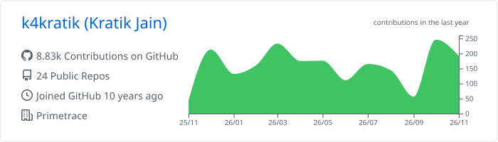
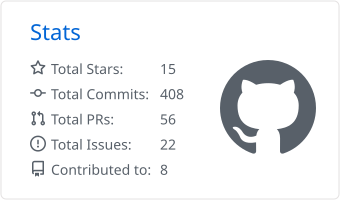
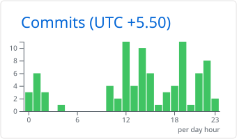
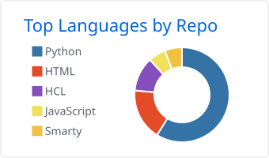
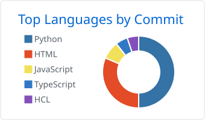

<h1 align="center">Hi 👋, I'm Kratik</h1>

<h3 align="center">Infrastructure Lead · DevOps · Cloud · Security · SRE — from India 🇮🇳</h3>

  

- 🏢 I'm the **Infrastructure Lead at Primetrace** (Crafto/Kutumb App), looking after infra, security and cloud cost for apps with ~4M daily users

- 🔭 Day to day: **AWS, Kubernetes (EKS), Terraform, Karpenter, ArgoCD, VictoriaMetrics, Loki, Elastic APM**

- 🛡️ Lately into **DevSecOps** (DefectDojo, Semgrep, Trivy, Gitleaks) and **FinOps** (cost reports, anomaly alerts, finding that extra 1%)

- 🧰 I build small tools when existing ones fall short: [MySQL Awesome Stats Collector](https://github.com/k4kratik/mysql-awesome-stats-collector), [ElastiCache Hot Shard Debugger](https://github.com/k4kratik/redis-hot-shard-debugger), [Smart RDS Viewer](https://github.com/k4kratik/smart-rds-viewer) (all on PyPI)

- 🤝 Contributed to **Argo Workflows, AWS SDK for JavaScript, Bitnami Charts, terraform-aws-iam, external-secrets, Robusta** and more

- 📝 I write at [blogs.kratik.dev](https://blogs.kratik.dev)

- 💻 Try my resume in the terminal: `ssh ssh.kratik.dev` · or on the web: [resume.kratik.dev](https://resume.kratik.dev)

- 🥇 Certifications: [CKA](https://www.credly.com/badges/013d7644-759e-4af6-bebf-850ac344bbb5/public_url) (99/100, 2025 · [100/100 in 2020](https://www.credly.com/badges/53515af8-bc86-48a4-b84f-3606950163b1/)) · [CKS](https://www.credly.com/badges/1cf75ff0-c43b-492f-a6fe-b6fe1ccd5b7d/public_url) · [AWS DevOps Professional](https://www.credly.com/badges/9f38a6e4-c687-4f98-880f-a5758e9691be/public_url)

- 📫 Reach me at **kratik.ops@gmail.com**

<h3 align="left">Connect with me:</h3>

    
    
    

<h3 align="left">Tools I work with:</h3>

    
    
    
    
    
    
    
    
    
    
    
    
    
    
    
    
    
    

<h3 align="left">GitHub insights:</h3>

<picture><source media="(prefers-color-scheme: dark)" srcset="profile-summary-card-output/github_dark/0-profile-details.svg" /></picture>

<picture><source media="(prefers-color-scheme: dark)" srcset="profile-summary-card-output/github_dark/3-stats.svg" /></picture> <picture><source media="(prefers-color-scheme: dark)" srcset="profile-summary-card-output/github_dark/4-productive-time.svg" /></picture>

<picture><source media="(prefers-color-scheme: dark)" srcset="profile-summary-card-output/github_dark/1-repos-per-language.svg" /></picture> <picture><source media="(prefers-color-scheme: dark)" srcset="profile-summary-card-output/github_dark/2-most-commit-language.svg" /></picture>

---
<h3 align="left">Support:</h3>

  
